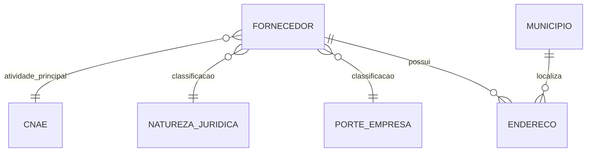

# Curadoria de Fornecedores e Compras Públicas

Projeto acadêmico da disciplina de Banco de Dados II (Java 17, Spring Boot, Spring Data JPA e H2) para cadastrar, consultar e organizar dados de fornecedores relacionados às compras públicas.

## Requisitos e execução

- JDK 17 e Maven (ou Maven Wrapper incluído).
- Banco H2 em arquivo local `./data/curadoria`; credenciais padrão de desenvolvimento `sa` sem senha.
- Na raiz do projeto, execute `./mvnw spring-boot:run` (Windows: `mvnw.cmd spring-boot:run`). Para rodar os testes: `./mvnw test` (Windows: `mvnw.cmd test`).
- API em `http://localhost:8080/api/fornecedores`; console H2 em `/h2-console` durante desenvolvimento.

O Hibernate mantém o esquema com `ddl-auto=update` para facilitar o protótipo acadêmico. Antes de produção, use migrações versionadas (por exemplo Flyway) e revise credenciais, console H2 e política de backup. Não há credenciais externas configuradas.

## API de fornecedores

| Método | Rota | Descrição |
|---|---|---|
| GET | `/api/fornecedores?page=0&size=20&sort=razaoSocial,asc` | Lista paginada; `busca` filtra razão social e `ativo` filtra situação |
| GET | `/api/fornecedores/{id}` | Consulta por identificador |
| GET | `/api/fornecedores/cnpj/{cnpj}` | Consulta por CNPJ; aceita máscara |
| POST | `/api/fornecedores` | Cadastra e retorna `201 Created` |
| PUT | `/api/fornecedores/{id}` | Atualiza os campos permitidos |
| DELETE | `/api/fornecedores/{id}` | Exclui e retorna `204 No Content` |

Exemplo de criação (os códigos de classificações precisam existir previamente no banco):

```json
{
  "cnpj": "04.252.011/0001-10",
  "cpf": null,
  "razaoSocial": "Empresa Exemplo Ltda.",
  "ativo": true,
  "habilitadoLicitar": false,
  "cnaeCodigo": null,
  "naturezaJuridicaCodigo": null,
  "porteEmpresaCodigo": null
}
```

Respostas de erro têm o formato `{"erro":"...","detalhes":[...]}`. Entradas inválidas retornam 400, entidades inexistentes 404 e conflitos de unicidade/referência 409. Listagens limitam o tamanho máximo da página a 100.

## Modelo e curadoria

`Fornecedor` referencia CNAE, natureza jurídica e porte por chave estrangeira, e possui endereços próprios. `Endereco` referencia um fornecedor e opcionalmente um município; classificações e municípios podem ser compartilhados e não são removidos em cascata. Restrições únicas protegem CNPJ e o par município/UF. Essa separação reduz repetição de descrições classificatórias (3FN para essas dependências); endereços permanecem associados ao fornecedor, com campos originais, fonte e data de consulta para rastreabilidade.



A API normaliza CNPJ (remove pontuação e converte letras para maiúsculas), espaços e UF antes de persistir. A validação verifica formato e dígitos verificadores, incluindo o formato alfanumérico previsto pela Receita Federal. Registros inválidos são rejeitados com motivo; o projeto não preenche informações desconhecidas.

## Dados públicos e limitações

- Compras.gov.br publica API REST de dados abertos, incluindo o módulo de fornecedores. O manual oficial descreve consulta paginada com filtros por CNPJ/CPF, natureza, porte e CNAE; limite informado de 500 registros por página. Consulte o [Portal de Dados Abertos de Compras](https://www.gov.br/compras/pt-br/cidadao/portal-de-dados-abertos/portal-de-dados-abertos), a [documentação interativa](https://dadosabertos.compras.gov.br/swagger-ui/index.html) e o [manual oficial da API](https://www.gov.br/compras/pt-br/acesso-a-informacao/manuais/manual-dados-abertos/manual-api-compras.pdf) antes de integrar ou reprocessar.
- A Receita Federal disponibiliza arquivos abertos de CNPJ, com arquivos e metadados no [repositório oficial](https://www.gov.br/receitafederal/dados) e informações cadastrais em [Cadastros](https://www.gov.br/receitafederal/pt-br/acesso-a-informacao/dados-abertos/cadastros). O layout inclui arquivos separados para empresas e estabelecimentos.
- O README original não definia formato de importação, versão de contrato, licença ou regra de precedência entre fontes. Portanto, este projeto entrega a API CRUD e as regras locais de validação/normalização, mas ainda não baixa/importa dados externos. A integração real requer definir a política de importação, campos de auditoria por lote e tratamento de registros rejeitados; não há chamadas simuladas nem dados fictícios.
- O modelo mantém uma atividade CNAE principal por fornecedor, seguindo a cardinalidade existente; atividades secundárias exigiriam confirmação do formato de origem e uma tabela de associação.
- O modelo preserva os atributos iniciais de habilitação, mas a API pública não deve ser interpretada como fonte de autorização para licitar sem validar a origem e a atualização desses dados.

## Tecnologias

Java 17, Spring Boot, Spring MVC, Jakarta Validation, Spring Data JPA, Hibernate e H2.

## Autores

Projeto acadêmico desenvolvido por Inocencio-Ferraz, Clebio-Luis e David-ksantos.
